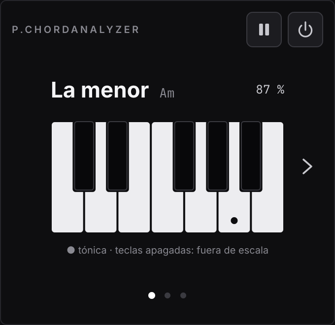
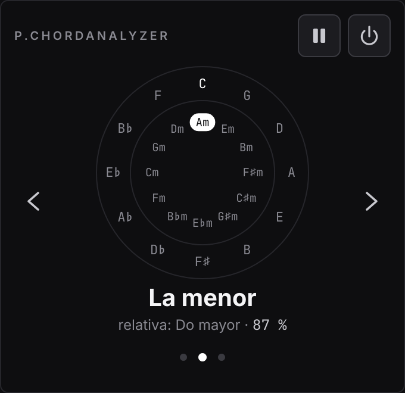
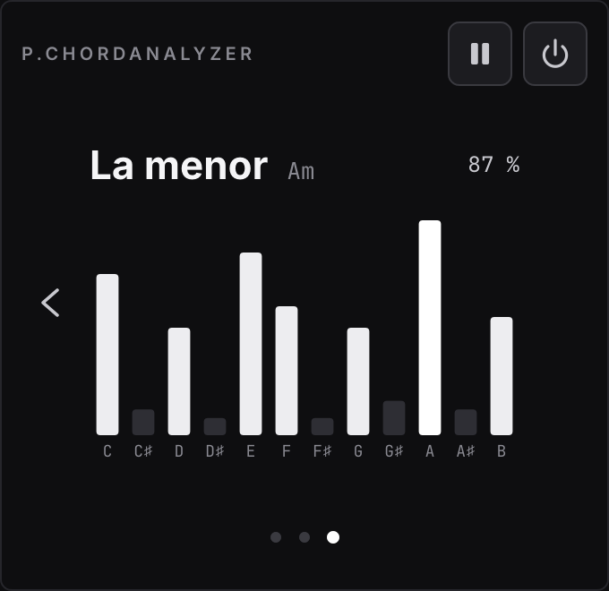

# P.ChordAnalyzer

Plugin VST3 para FL Studio que detecta **en tiempo real la escala** de lo que suena y la muestra en una ventana pequeña y oscura. Solo analiza: **no toca el audio** y no añade latencia.

<p align="center">
  
  
  
</p>

## Qué hace

- Detecta la tonalidad (12 mayores y 12 menores) de lo que entra al plugin y la muestra en español ("La menor") con su cifrado ("Am"), su relativa y un porcentaje de confianza.
- Se fija en la sección que suena (unos 6 s de memoria), no en cada acorde suelto, y la escala solo cambia cuando la nueva lleva al menos 1,5 s ganando. Nada de parpadeos.
- Si el audio se para (FL detenido, huecos entre loops), mantiene la última escala.
- Tres vistas que se cambian con las flechas o los puntos:
  - **Teclado:** una octava con las notas de la escala encendidas y la tónica marcada.
  - **Círculo de quintas** (vista por defecto): la escala en una píldora blanca y su relativa al lado.
  - **Cromagrama:** la energía de cada nota en directo.
- **Congelar** (botón de pausa): la ventana deja de actualizarse para que puedas leer con calma; el análisis sigue por detrás.
- **Bypass** (botón de encendido): detiene el análisis (CPU ≈ 0). El audio sigue pasando intacto.
- La vista abierta, congelar y bypass se guardan con el proyecto de FL.

## Instalación en FL Studio (Windows)

1. Descarga el plugin compilado:
   - Entra en la pestaña **Actions** del repositorio y abre la última ejecución en verde de **Compilar (Windows)**.
   - Abajo, en **Artifacts**, descarga `P.ChordAnalyzer-VST3` (y si quieres la app independiente, `P.ChordAnalyzer-Standalone`).
2. Descomprime el zip y copia la carpeta **`PChordAnalyzer.vst3`** en:
   ```
   C:\Program Files\Common Files\VST3\
   ```
3. En FL Studio abre **Options → Manage plugins**, pulsa **Find installed plugins** y marca **P.ChordAnalyzer** como favorito si quieres tenerlo a mano.
4. Añádelo en un slot del **Mixer**: en el Master para analizar toda la mezcla, o en una pista concreta para analizar solo ese instrumento.

### Aplicación independiente (.exe)

`PChordAnalyzer.exe` escucha la entrada de audio del sistema. En **Options → Audio/MIDI Settings** elige la entrada: un micrófono, una interfaz de audio o "Mezcla estéreo" (*Stereo Mix*) para analizar lo que suena en el PC. La app no reenvía el audio a los altavoces, así que no hay acoples.

## Cómo funciona

1. **Hilo de audio:** cada bloque se deja pasar intacto y solo se copia la mezcla mono `(L+R)/2` a una cola sin bloqueos. Nada de reservar memoria, locks ni logs en ese hilo.
2. **Hilo de análisis** (unas 10 veces por segundo):
   - **Cromagrama:** FFT de 8192 muestras con ventana de Hann y salto de 2048. Se buscan los picos entre 55 Hz y 5 kHz, se afina su frecuencia por interpolación parabólica y su energía se suma en su nota (todas las octavas juntas).
   - **Acumulación:** media de las tramas que pasa a ser exponencial con 6 s de memoria.
   - **Tonalidad:** correlación con los 24 perfiles de **Krumhansl-Kessler**. Se probaron también los de Temperley, pero con loops de electrónica / hip-hop confunden a menudo la menor con su relativa mayor (48/48 aciertos frente a 39/48 en los tests).
   - **Confianza:** diferencia entre la mejor escala y la segunda.
   - **Histéresis:** la nueva escala tiene que ser la mejor durante 1,5 s seguidos y ganar a la actual por un margen mínimo.
   - **Silencio:** por debajo de -60 dBFS no se toca nada.
3. **Interfaz:** lee el último resultado como mucho 30 veces por segundo y solo repinta lo que cambia.

**Rendimiento:** el análisis usa alrededor del 0,4 % de un núcleo (lo mide un test).

## Compilación

El proyecto usa **JUCE 8** y **CMake**. JUCE se descarga solo al configurar.

- **GitHub Actions** (lo normal): cada push a `main` o cada pull request compila en Windows, pasa los tests y sube el `.vst3` y el `.exe` como artefactos. También se puede lanzar a mano desde Actions.
- **En local** (Windows con Visual Studio, macOS o Linux):
  ```bash
  cmake -S . -B build -DCMAKE_BUILD_TYPE=Release
  cmake --build build --config Release
  ctest --test-dir build -C Release --output-on-failure
  ```

### Tests

`Tests/` genera audio sintético (acordes y melodías con armónicos) y comprueba:

- las 24 escalas a 44,1 y 48 kHz;
- que con un loop estable la escala no cambia nunca;
- el silencio;
- la histéresis al modular;
- el hilo de análisis y el bypass;
- el guardado del estado;
- que la CPU queda por debajo del 1 %.

### Capturas

`Tools/Capturas.cpp` dibuja la interfaz con resultados de ejemplo y guarda PNG (las de este README):

```bash
cmake -S . -B build -DPCA_CAPTURAS=ON
cmake --build build --target PChordAnalyzerCapturas --config Release
```

## Estructura

```
Source/
  PluginProcessor.*     Audio en paso directo, parámetro de bypass y estado
  PluginEditor.*        Ventana del plugin: conecta la interfaz con el procesador
  EstadoPlugin.*        Guardado y carga del estado (vista, congelar, bypass)
  StandaloneApp.cpp     App independiente que escucha la entrada del sistema
  Analysis/             Motor de detección (sin interfaz, testeable)
  UI/                   Tema, cabecera, vistas, carrusel y puntos
Resources/Fonts/        Inter y JetBrains Mono (OFL)
Tests/                  Tests unitarios
Tools/                  Herramienta de capturas
docs/                   Especificación y capturas
```

## Licencia

- Código: **GNU AGPL v3** (ver [`LICENSE`](LICENSE)), compatible con la licencia de código abierto de JUCE 8.
- Tipografías: [Inter](https://github.com/rsms/inter) y [JetBrains Mono](https://github.com/JetBrains/JetBrainsMono), ambas con licencia SIL Open Font License 1.1 (ver [`Resources/Fonts`](Resources/Fonts)).
